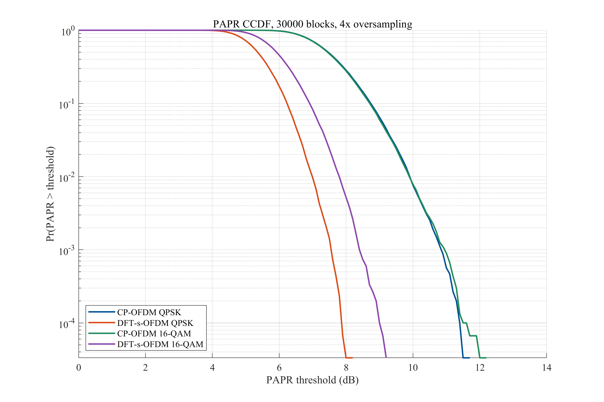
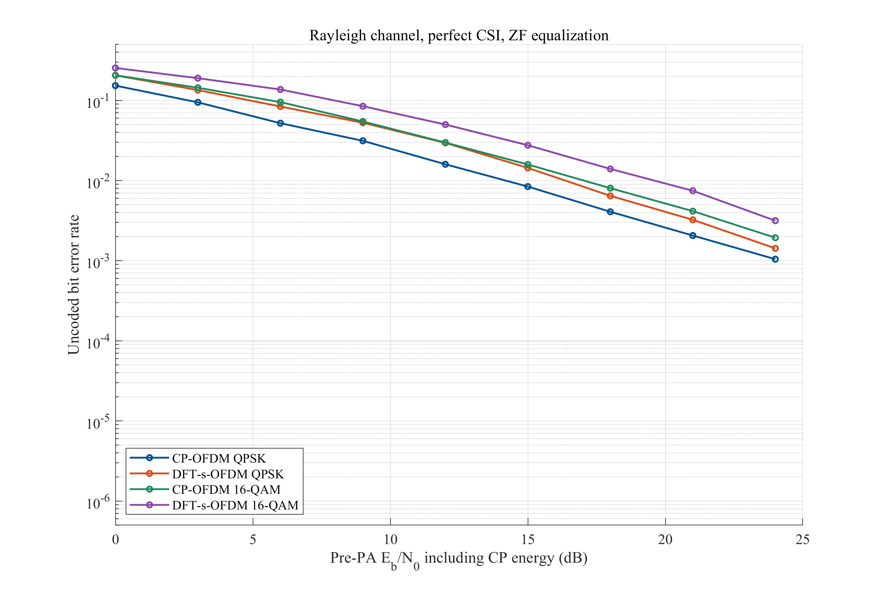

# 5G Uplink Waveform Comparison in MATLAB

**MATLAB · Digital Communications · CP-OFDM · DFT-s-OFDM · Waveform Simulation**

[中文说明](README_CN.md) · [English report](01_测验报告/英文报告_测验版.docx) · [中文报告](01_测验报告/中文报告_测验版.docx) · [MATLAB quick start](#run-the-project)

An undergraduate digital communications project comparing CP-OFDM and localized DFT-s-OFDM under matched bandwidth, modulation order and average input energy. The simulations examine peak-to-average power ratio (PAPR), bit error rate (BER), clipping distortion and power spectral density (PSD).

**Project scope:** a simplified single-user 5G uplink waveform study with uncoded QPSK and 16-QAM, ideal synchronization, known channels and zero-forcing (ZF) equalization. The repository contains saved MATLAB results and working report drafts; it does not implement a complete 3GPP NR link.

## Highlights

| Comparison | Result in the saved full run |
|---|---|
| PAPR, QPSK | At the 99th percentile, DFT-s-OFDM reduces PAPR from **9.90 dB to 6.98 dB** |
| PAPR, 16-QAM | At the same percentile, PAPR falls from **9.89 dB to 7.80 dB** |
| Linear AWGN channel | Both waveforms have similar BER at matched modulation order and bit energy |
| Rayleigh multipath with ZF | DFT-s-OFDM has higher BER in this configuration, despite its lower PAPR |
| Hard-limiter experiment | At 2 dB input back-off and 14 dB pre-amplifier Eb/N0, 16-QAM BER falls from **0.00512 to 0.00121** with DFT spreading |
| Saved evidence | Six result figures, CSV tables, native MAT/FIG files and execution logs |

### Lower peaks under the same bandwidth and modulation



The full run uses 30,000 waveform blocks for each PAPR curve. The 99th-percentile reduction is about 2.92 dB for QPSK and 2.09 dB for 16-QAM.

### Error performance depends on the channel and receiver



The Rayleigh/ZF result retains a disadvantage of DFT spreading: a lower PAPR does not imply a lower BER in every channel. The linear AWGN comparison and the nonlinear hard-limiter experiment are separate cases in the dataset.

## Run the project

The archived full run used **MATLAB R2024a**. Download the repository and set MATLAB Current Folder to `02_MATLAB仿真`, then run:

```matlab
run_5g_uplink('test')  % Deterministic modem, energy and transmit/receive checks
run_5g_uplink('full')  % Full Monte Carlo simulation
```

A shorter debugging run is also available:

```matlab
run_5g_uplink('quick')
```

New runs write to `02_MATLAB仿真/results/<mode>_<timestamp>/`. The committed full-run evidence remains in `02_MATLAB仿真/完整结果_20261027_132725/`.

## Simulation setup

| Setting | Value |
|---|---|
| Base FFT size / active subcarriers | 256 / 72 contiguous subcarriers |
| Base cyclic prefix / waveform oversampling | 18 samples / 4 times |
| Subcarrier spacing | 15 kHz |
| Modulation and coding | QPSK and Gray-coded 16-QAM; no channel coding |
| Linear channels | AWGN and four-tap Rayleigh multipath |
| Receiver | Perfect channel knowledge and ZF equalization |
| Amplifier model | Memoryless hard limiter with matched mean input power |

See the [experiment definitions](02_MATLAB仿真/实验设计说明.txt) for noise scaling, sampling budgets, gain calibration and metric definitions.

## Reports and interpretation

The [English report](01_测验报告/英文报告_测验版.docx) and [Chinese report](01_测验报告/中文报告_测验版.docx) are editable coursework drafts with equations, figures, references and a MATLAB code appendix. The Chinese file is the locally saved version from 2026-11-05; the English file is the current English test draft. They can be revised independently.

The hard-limiter results describe this simulation model. They do not measure amplifier efficiency, battery life or network coverage. The Rayleigh result also depends on the chosen receiver; this comparison does not establish that one waveform is universally better.

## Repository guide

| Directory | Contents |
|---|---|
| [`01_测验报告/`](01_测验报告/) | Chinese and English Word report drafts |
| [`02_MATLAB仿真/`](02_MATLAB仿真/) | Runnable MATLAB source and experiment definitions |
| [`02_MATLAB仿真/完整结果_20261027_132725/`](02_MATLAB仿真/完整结果_20261027_132725/) | Six PNG/PDF figures, editable FIG files, CSV/MAT data and execution records |
| [`03_参考文献/`](03_参考文献/) | 17 English research-paper references, BibTeX and verification records |