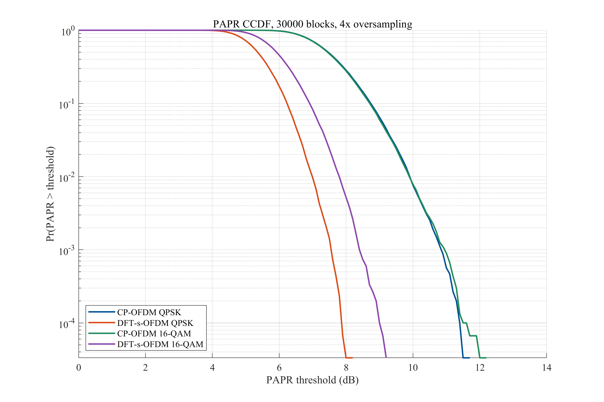
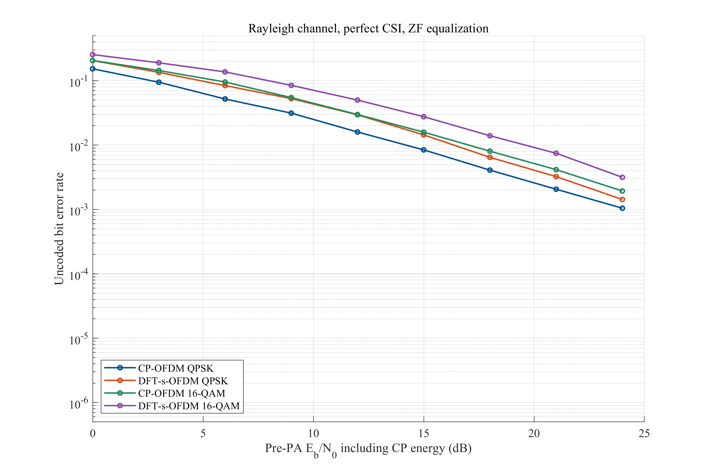

# 5G 上行通信波形比较：CP-OFDM 与 DFT-s-OFDM

**MATLAB · 数字通信 · CP-OFDM · DFT-s-OFDM · 波形仿真**

[English overview](README.md) · [中文报告](01_测验报告/中文报告_测验版.docx) · [英文报告](01_测验报告/英文报告_测验版.docx)

本科数字通信课程项目。在相同带宽、调制阶数和平均输入能量下，比较 CP-OFDM 与局部映射 DFT-s-OFDM 的峰均比（PAPR）、误码率（BER）、限幅失真和功率谱密度（PSD）。

**项目范围：**简化的单用户 5G 上行波形仿真，采用未编码 QPSK 和 16-QAM、理想同步、已知信道及零迫（ZF）均衡。仓库保存真实 MATLAB 运行结果和报告草稿，不是完整的 3GPP NR 链路实现。

## 主要结果

| 比较项目 | 本次完整仿真结果 |
|---|---|
| QPSK 峰均比 | 第 99 百分位由 **9.90 dB 降到 6.98 dB** |
| 16-QAM 峰均比 | 同一百分位由 **9.89 dB 降到 7.80 dB** |
| 线性 AWGN 信道 | 相同调制阶数与比特能量下，两种波形的 BER 接近 |
| 瑞利多径信道与 ZF 接收机 | DFT-s-OFDM 的 BER 较高，较低峰均比不代表误码性能总是更好 |
| 硬限幅功放实验 | 输入回退为 2 dB、功放前 Eb/N0 为 14 dB 时，16-QAM BER 由 **0.00512 降到 0.00121** |
| 保存资料 | 六幅结果图、CSV 表格、MAT/FIG 原始文件及运行日志 |

### 相同带宽和调制下的峰均比



每条 PAPR 曲线使用 30,000 个波形块。第 99 百分位的峰均比降低约为 2.92 dB（QPSK）和 2.09 dB（16-QAM）。

### 信道和接收机也会影响误码性能



瑞利信道结果保留了 DFT 扩频在本配置下的不利表现。线性 AWGN 实验与非线性硬限幅实验分别保存在对应数据和图表中。

## 运行方法

已保存的完整结果由 **MATLAB R2024a** 生成。下载仓库后，将 MATLAB 当前文件夹切换到 `02_MATLAB仿真`，依次运行：

```matlab
run_5g_uplink('test')  % 调制、能量归一化及收发链路检查
run_5g_uplink('full')  % 完整蒙特卡洛仿真
```

调试时也可以运行较短的版本：

```matlab
run_5g_uplink('quick')
```

新结果写入 `02_MATLAB仿真/results/<模式>_<时间>/`。仓库中的正式结果保留在独立的 `完整结果_20261027_132725` 目录中。

## 仿真设置

| 设置 | 数值或方法 |
|---|---|
| 基础 FFT 长度 / 激活子载波 | 256 / 72 个连续子载波 |
| 基础循环前缀 / 波形过采样 | 18 个采样点 / 四倍 |
| 子载波间隔 | 15 kHz |
| 调制和编码 | QPSK、格雷映射 16-QAM；不使用信道编码 |
| 线性信道 | AWGN、四径瑞利多径信道 |
| 接收机 | 已知信道、ZF 均衡 |
| 功放模型 | 相同平均输入功率下的无记忆硬限幅器 |

噪声归一化、采样数量、增益校准和指标定义见 [实验设计说明](02_MATLAB仿真/实验设计说明.txt)。

## 报告与结果解释

[中文版 Word](01_测验报告/中文报告_测验版.docx) 与 [英文版 Word](01_测验报告/英文报告_测验版.docx) 均为可继续修改的课程报告草稿，包含公式、图表、参考文献和 MATLAB 代码附录。中文稿采用 2026-11-05 本地已保存的版本，英文稿采用当前英文测验版；两份文稿可以分别继续修改。

硬限幅实验反映的是当前仿真模型，不直接代表实际功放效率、手机续航或网络覆盖。瑞利信道下的结论也与所用接收机有关，不能据此断言某种波形在所有情况下都更好。

## 目录说明

| 目录 | 内容 |
|---|---|
| [`01_测验报告/`](01_测验报告/) | 中文和英文 Word 测验版 |
| [`02_MATLAB仿真/`](02_MATLAB仿真/) | MATLAB 程序与实验设计说明 |
| [`02_MATLAB仿真/完整结果_20261027_132725/`](02_MATLAB仿真/完整结果_20261027_132725/) | 六幅 PNG/PDF 图、可编辑 FIG 图形、CSV/MAT 数据和运行记录 |
| [`03_参考文献/`](03_参考文献/) | 17 篇英文论文条目、BibTeX 和文献核验资料 |